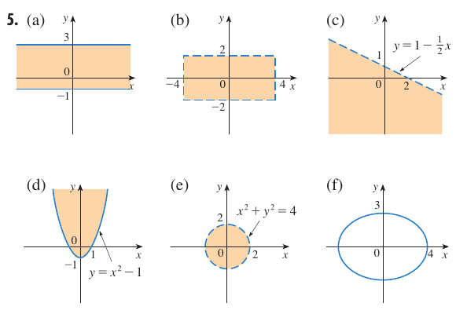

::: {style="max-width: 70ch; margin: 0 auto; padding: 2rem 5%;"}

# Examen de diagnóstico B: Geometría analítica

Las consignas y las respuestas finales proceden de James Stewart, sexta edición, examen de diagnóstico B, página impresa xxii (página física 24 del PDF). Los desarrollos inmediatamente posteriores a cada consigna son **elaboración docente**, no respuestas transcritas del libro. Primero intentá resolver los ejercicios; al final podés consultar las [respuestas del libro](#respuestas-del-libro).

## Ejercicio 1 {#ejercicio-1}

Encuentre una ecuación para la recta que pasa por el punto $(2,-5)$ y

- **(a)** tiene pendiente $-3$
- (b) es paralela al eje $x$
- (c) es paralela al eje $y$
- (d) es paralela a la recta $2x-4y=3$

### Desarrollo docente {#desarrollo-1}

- **(a)** La forma punto-pendiente es $y-y_1=m(x-x_1)$. Con $m=-3$ y $(x_1,y_1)=(2,-5)$ obtenemos $y+5=-3(x-2)$; al despejar, $y=-3x+1$.
- (b) Una recta paralela al eje $x$ es horizontal: todos sus puntos tienen la misma ordenada. Como pasa por $(2,-5)$, su ecuación es $y=-5$.
- (c) Una recta paralela al eje $y$ es vertical: todos sus puntos tienen la misma abscisa. Por el punto dado, $x=2$. Esta recta no tiene pendiente definida.
- (d) Despejamos la recta dada: $y=\frac12x-\frac34$, de pendiente $\frac12$. La paralela tiene la misma pendiente, por lo que $y+5=\frac12(x-2)$ y, finalmente, $y=\frac12x-6$.

## Ejercicio 2 {#ejercicio-2}

Encuentre una ecuación para el círculo que tiene centro en $(-1,4)$ y pasa por el punto $(3,-2)$.

### Desarrollo docente {#desarrollo-2}

1. El cuadrado del radio es la distancia al cuadrado entre el centro y el punto: $r^2=(3-(-1))^2+(-2-4)^2=16+36=52$.
2. En la forma $(x-h)^2+(y-k)^2=r^2$, sustituimos $h=-1$, $k=4$ y $r^2=52$. Así, $(x+1)^2+(y-4)^2=52$.

## Ejercicio 3 {#ejercicio-3}

Encuentre el centro y radio del círculo con ecuación $x^2+y^2-6x+10y+9=0$.

### Desarrollo docente {#desarrollo-3}

1. Agrupamos y pasamos el término independiente: $(x^2-6x)+(y^2+10y)=-9$.
2. Completamos cuadrados sumando $9$ y $25$ en ambos miembros: $(x-3)^2+(y+5)^2=-9+9+25=25$.
3. Comparando con $(x-h)^2+(y-k)^2=r^2$, el centro es $(3,-5)$ y el radio positivo es $r=5$.

## Ejercicio 4 {#ejercicio-4}

Sean $A(-7,4)$ y $B(5,-12)$ puntos en el plano.

- **(a)** Encuentre la pendiente de la recta que contiene $A$ y $B$.
- (b) Encuentre una ecuación de la recta que pasa por $A$ y $B$. ¿Cuáles son los puntos de intersección con los ejes?
- (c) Encuentre el punto medio del segmento $AB$.
- (d) Encuentre la longitud del segmento $AB$.
- (e) Encuentre una ecuación de la perpendicular que biseca a $AB$.
- (f) Encuentre una ecuación del círculo para el cual $AB$ es un diámetro.

### Desarrollo docente {#desarrollo-4}

- **(a)** El cambio vertical es $-12-4=-16$ y el horizontal es $5-(-7)=12$. Por tanto, $m=\frac{-16}{12}=-\frac43$.
- (b) Con $A$ y la pendiente hallada, $y-4=-\frac43(x+7)$. Al multiplicar y ordenar, $4x+3y+16=0$. Para el eje $x$ hacemos $y=0$ y obtenemos $x=-4$; para el eje $y$ hacemos $x=0$ y obtenemos $y=-\frac{16}{3}$. Los puntos son $(-4,0)$ y $(0,-\frac{16}{3})$.
- (c) Promediamos las coordenadas: $M=(\frac{-7+5}{2},\frac{4-12}{2})=(-1,-4)$.
- (d) La fórmula de distancia da $AB=\sqrt{12^2+(-16)^2}=\sqrt{400}=20$.
- (e) La mediatriz pasa por $M$ y es perpendicular a $AB$. Su pendiente es la recíproca opuesta de $-\frac43$, es decir, $\frac34$. Entonces $y+4=\frac34(x+1)$; al ordenar, $3x-4y=13$.
- (f) El centro es el punto medio $M=(-1,-4)$ y el radio es la mitad del diámetro: $r=20/2=10$. Por eso $(x+1)^2+(y+4)^2=100$.

## Ejercicio 5 {#ejercicio-5}

Trace la región en el plano $xy$ definida por la ecuación o desigualdades.

- **(a)** $-1\leq y\leq 3$
- (b) $|x|<4$ y $|y|<2$
- (c) $y<1-\frac12x$
- (d) $y\geq x^2-1$
- (e) $x^2+y^2<4$
- (f) $9x^2+16y^2=144$

### Desarrollo docente {#desarrollo-5}

- **(a)** Dibujamos las horizontales $y=-1$ y $y=3$. Como ambas desigualdades incluyen la igualdad, las trazamos continuas y sombrearemos toda la franja entre ellas, que se extiende indefinidamente en ambas direcciones horizontales.
- (b) Las condiciones equivalen a $-4<x<4$ y $-2<y<2$. Dibujamos el rectángulo entre esas cuatro rectas y sombrearemos su interior. Las cuatro fronteras son discontinuas y no se incluyen, porque las desigualdades son estrictas.
- (c) La frontera $y=1-\frac12x$ pasa por $(0,1)$ y $(2,0)$. La trazamos discontinua porque hay desigualdad estricta. El punto $(0,0)$ satisface $0<1$, así que sombrearemos el semiplano debajo de la recta, del lado del origen.
- (d) La frontera $y=x^2-1$ es una parábola de vértice $(0,-1)$, abierta hacia arriba, que corta el eje $x$ en $(-1,0)$ y $(1,0)$. La dibujamos continua porque se admite la igualdad y sombrearemos los puntos por encima de ella.
- (e) La frontera $x^2+y^2=4$ es una circunferencia de centro $(0,0)$ y radio $2$. La desigualdad exige distancia al origen menor que $2$: sombrearemos el interior y dibujamos la frontera discontinua, sin incluirla.
- (f) Dividimos por $144$: $\frac{x^2}{16}+\frac{y^2}{9}=1$. La ecuación describe solo la elipse, no su interior: su centro es el origen y corta los ejes en $(\pm4,0)$ y $(0,\pm3)$. La curva se dibuja continua.

## Respuestas del libro {#respuestas-del-libro}

Las expresiones y las seis gráficas siguientes reproducen la sección de respuestas de la página xxii; las explicaciones anteriores son independientes de ella. La marca «(a)» de la respuesta 2 aparece así en el libro, aunque el ejercicio 2 no tiene incisos: es una errata de rotulación, no un cambio en la respuesta matemática. En la respuesta 4 también se conserva la ausencia de la marca «(a)» antes de la pendiente.

**1.** (a) $y=-3x+1$; (b) $y=-5$; (c) $x=2$; (d) $y=\frac12x-6$.

**2.** (a) $(x+1)^2+(y-4)^2=52$.

**3.** Centro $(3,-5)$, radio $5$.

**4.** $-\frac43$; (b) $4x+3y+16=0$; cruce con eje $x$ $-4$, cruce con eje $y$ $-\frac{16}{3}$; (c) $(-1,-4)$; (d) $20$; (e) $3x-4y=13$; (f) $(x+1)^2+(y+4)^2=100$.

**5.** Gráficas originales del libro: (a) franja cerrada entre $y=-1$ e $y=3$; (b) interior de un rectángulo con fronteras discontinuas en $x=\pm4$ e $y=\pm2$; (c) semiplano inferior a la recta discontinua; (d) región por encima de la parábola continua; (e) interior de la circunferencia discontinua de radio $2$; (f) elipse sin sombreado, con intersecciones $4$ y $3$ en los semiejes positivos.

{width=100%}

:::
