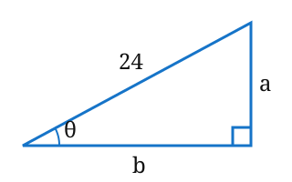
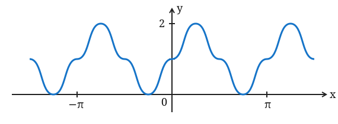

**Fuente:** James Stewart, *Cálculo*, sexta edición, página física 26 del PDF (página impresa xxiv). Las consignas reproducen el examen; los desarrollos intercalados son de elaboración docente.

## Ejercicio 1 {#ejercicio-1}

Convierta de grados a radianes.

(a) $300^\circ$  (b) $-18^\circ$

### Desarrollo docente

Una vuelta completa equivale tanto a $360^\circ$ como a $2\pi$ radianes; por lo tanto, multiplicamos cada medida en grados por $\pi/180$.

- (a) $300^\circ\cdot\dfrac{\pi}{180^\circ}=\dfrac{5\pi}{3}$ radianes.
- (b) $-18^\circ\cdot\dfrac{\pi}{180^\circ}=-\dfrac{\pi}{10}$ radianes. El signo negativo conserva el sentido del giro.

## Ejercicio 2 {#ejercicio-2}

Convierta de radianes a grados.

(a) $5\pi/6$  (b) $2$

### Desarrollo docente

Multiplicamos por $180^\circ/\pi$, pues $\pi$ radianes equivalen a $180^\circ$.

- (a) $\dfrac{5\pi}{6}\cdot\dfrac{180^\circ}{\pi}=150^\circ$.
- (b) $2\cdot\dfrac{180^\circ}{\pi}=\dfrac{360}{\pi}^\circ\approx114,6^\circ$. El valor con $\pi$ es exacto; el decimal es aproximado.

## Ejercicio 3 {#ejercicio-3}

Encuentre la longitud de un arco de círculo con radio de 12 cm si el arco subtiende un ángulo central de $30^\circ$.

### Desarrollo docente

Primero expresamos el ángulo en radianes: $30^\circ=\pi/6$. La longitud de arco es $s=r\theta$ cuando $\theta$ está en radianes. Entonces

$$s=12\,\text{cm}\cdot\frac{\pi}{6}=2\pi\,\text{cm}.$$

## Ejercicio 4 {#ejercicio-4}

Encuentre los valores exactos.

(a) $\tan(\pi/3)$  (b) $\operatorname{sen}(7\pi/6)$  (c) $\sec(5\pi/3)$

### Desarrollo docente

- (a) En el primer cuadrante, $\operatorname{sen}(\pi/3)=\sqrt3/2$ y $\cos(\pi/3)=1/2$. Por cociente, $\tan(\pi/3)=\sqrt3$.
- (b) $7\pi/6=\pi+\pi/6$ está en el tercer cuadrante, donde el seno es negativo. Así, $\operatorname{sen}(7\pi/6)=-\operatorname{sen}(\pi/6)=-1/2$.
- (c) $5\pi/3=2\pi-\pi/3$ está en el cuarto cuadrante y su coseno es $1/2$. Como la secante es el recíproco del coseno, $\sec(5\pi/3)=2$.

## Ejercicio 5 {#ejercicio-5}

Exprese las longitudes $a$ y $b$ de la figura en términos de $\theta$.

### Desarrollo docente

Con respecto a $\theta$, el cateto opuesto es $a$, el adyacente es $b$ y la hipotenusa mide $24$. Por definición,

$$\operatorname{sen}\theta=\frac{a}{24},\qquad \cos\theta=\frac{b}{24}.$$

Multiplicando ambas igualdades por 24 obtenemos $a=24\operatorname{sen}\theta$ y $b=24\cos\theta$.

## Ejercicio 6 {#ejercicio-6}

Si $\operatorname{sen}x=\frac13$ y $\sec y=\frac54$, donde $x$ y $y$ están entre $0$ y $\pi/2$, evalúe $\operatorname{sen}(x+y)$.

### Desarrollo docente

1. Ambos ángulos están en el primer cuadrante, por lo que seno y coseno son positivos. La identidad pitagórica da $\cos x=\sqrt{1-(1/3)^2}=2\sqrt2/3$.
2. De $\sec y=5/4$ resulta $\cos y=4/5$; luego $\operatorname{sen}y=\sqrt{1-(4/5)^2}=3/5$.
3. Aplicamos la fórmula de la suma:

$$\operatorname{sen}(x+y)=\operatorname{sen}x\cos y+\cos x\operatorname{sen}y=\frac13\frac45+\frac{2\sqrt2}{3}\frac35=\frac{4+6\sqrt2}{15}.$$

El resultado es positivo, como corresponde al seno de la suma de dos ángulos en el primer cuadrante.

## Ejercicio 7 {#ejercicio-7}

Demuestre las identidades.

(a) $\tan\theta\operatorname{sen}\theta+\cos\theta=\sec\theta$

(b) $\dfrac{2\tan x}{1+\tan^2 x}=\operatorname{sen}2x$

### Desarrollo docente

Las igualdades se demuestran donde están definidas las expresiones con tangente y secante, es decir, cuando el coseno del ángulo no es cero.

- (a) Reemplazamos la tangente por el cociente de seno y coseno y sumamos con denominador común:

$$\tan\theta\operatorname{sen}\theta+\cos\theta=\frac{\operatorname{sen}^2\theta}{\cos\theta}+\frac{\cos^2\theta}{\cos\theta}=\frac{1}{\cos\theta}=\sec\theta.$$

- (b) Usamos $1+\tan^2x=\sec^2x$, sustituimos y simplificamos. La fórmula del ángulo doble completa la demostración:

$$\frac{2\tan x}{1+\tan^2x}=\frac{2(\operatorname{sen}x/\cos x)}{1/\cos^2x}=2\operatorname{sen}x\cos x=\operatorname{sen}2x.$$

## Ejercicio 8 {#ejercicio-8}

Encuentre todos los valores de $x$ tales que $\operatorname{sen}2x=\operatorname{sen}x$ y $0\leq x\leq2\pi$.

### Desarrollo docente

1. Reemplazamos $\operatorname{sen}2x$ por $2\operatorname{sen}x\cos x$ y pasamos todo a un lado:

$$\operatorname{sen}x(2\cos x-1)=0.$$

2. Si $\operatorname{sen}x=0$, en el intervalo cerrado se obtiene $x=0,\pi,2\pi$.
3. Si $2\cos x-1=0$, entonces $\cos x=1/2$, de donde $x=\pi/3$ o $x=5\pi/3$ en ese intervalo.
4. Reunimos ambas ramas sin dividir por el seno y sin perder los extremos: $x=0,\pi/3,\pi,5\pi/3,2\pi$.

## Ejercicio 9 {#ejercicio-9}

Trace la gráfica de la función $y=1+\operatorname{sen}2x$ sin usar calculadora.

### Desarrollo docente

1. La función $\operatorname{sen}2x$ tiene amplitud 1 y período $2\pi/2=\pi$. Al sumar 1, su línea media sube a $y=1$: el mínimo es 0 y el máximo es 2.
2. En un período, marcamos $(0,1)$, $(\pi/4,2)$, $(\pi/2,1)$, $(3\pi/4,0)$ y $(\pi,1)$. Unimos suavemente con la forma sinusoidal y repetimos cada $\pi$ hacia ambos lados.

