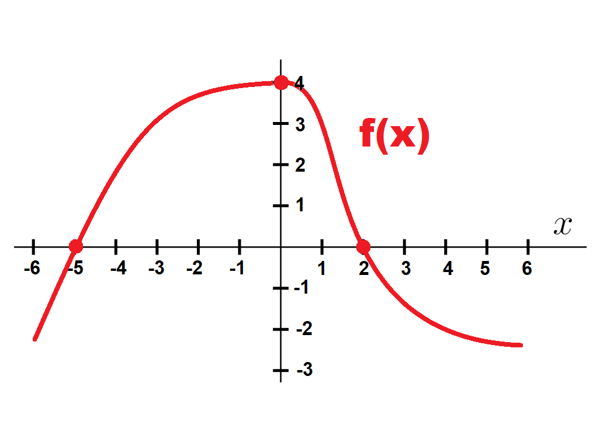
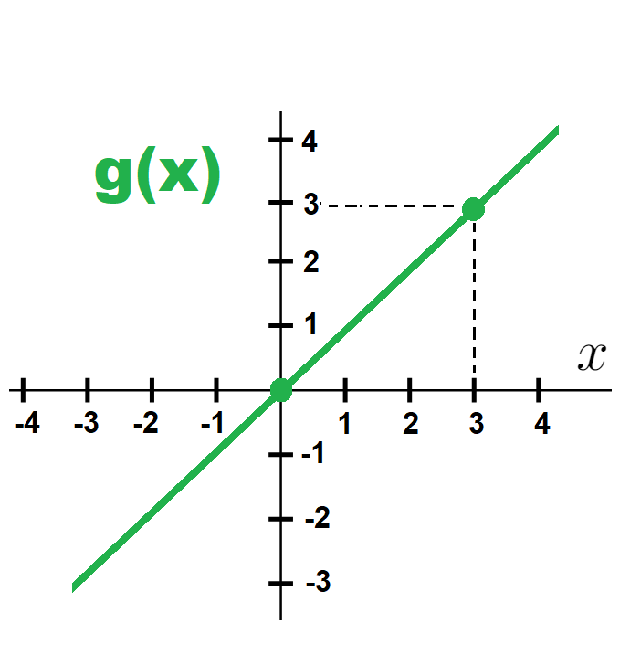
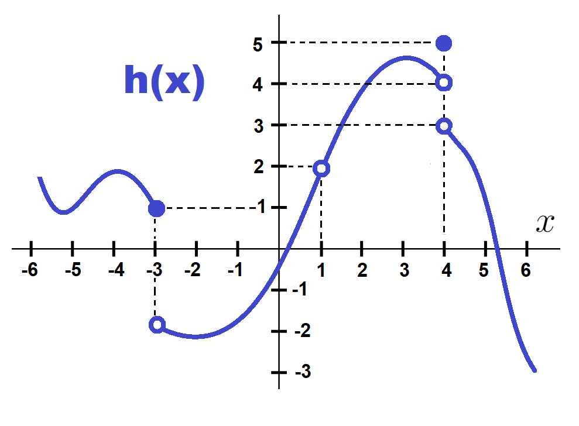
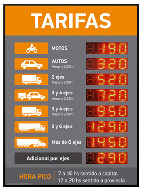

# TP2 · Límites — Resolución pedagógica

Resolución docente de [TP2 LIMITES.pdf](../material/pdf/TP2%20LIMITES.pdf), 5.º año, Prof. Damián Pedraza. Los enunciados y gráficos proceden del PDF; los desarrollos son elaboración propia, no un solucionario oficial.

## 1 · Leer límites y valores {#ej1}

**Fuente: TP2, p. 1, ejercicio 1.** En cada punto distinguimos cinco preguntas: límite izquierdo, límite derecho, límite bilateral, valor de la función y continuidad. Los círculos abiertos indican puntos excluidos; los cerrados fijan el valor puntual.

### Función roja · f(x) {#funcion-roja}

En $x=0$ ambas ramas se acercan a $4$ y el punto está incluido: $f(0)=4$. En $x=2$ las ramas se acercan a $0$ y $f(2)=0$. Lo mismo ocurre en la raíz marcada $x=-5$: el límite y el valor son $0$.

::: {#tabla-roja}
| Punto $a$ | Límite izquierdo | Límite derecho | Límite bilateral | $f(a)$ | Continuidad |
|---|---|---|---|---|---|
| -8 | Sin datos | Sin datos | No determinable | Sin datos | No determinable |
| -5 | $0$ | $0$ | $0$ | $0$ | Sí |
| 0 | $4$ | $4$ | $4$ | $4$ | Sí |
| 2 | $0$ | $0$ | $0$ | $0$ | Sí |
:::

**Ítems del TP:** 1 → $4$; 2, 3, 4 y 7 → $0$; 8 → no determinable; 19 → $0$; 20 → $4$.

El ítem 7 repite al 4. El ítem 8 pregunta por $x\to-8$, fuera de la zona mostrada: no tener información no significa que el límite no exista. No se prolonga la curva por intuición.

### Función verde · g(x) {#funcion-verde}

La recta representada es $g(x)=x$. Al acercarnos a $0$ las salidas se acercan a $0$; al acercarnos a $3$, a $3$. Ambos puntos están incluidos y no hay huecos ni saltos allí.

::: {#tabla-verde}
| Punto $a$ | Límite izquierdo | Límite derecho | Límite bilateral | $g(a)$ | Continuidad |
|---|---|---|---|---|---|
| 0 | $0$ | $0$ | $0$ | $0$ | Sí |
| 3 | $3$ | $3$ | $3$ | $3$ | Sí |
:::

**Ítems del TP:** 5 → $0$; 9 → $3$; 21 → $3$.

### Función azul · h(x) {#funcion-azul}

**Lectura precisa:** llamamos $b$ a la altura del círculo abierto inferior en $x=-3$ y $c$ a la altura de la curva en $x=0$. Son aproximaciones gráficas: $b\approx-2$ y $c\approx-0{,}5$. El dibujo no fija esos números exactamente. En particular, en $x=0$ la curva está bajo el eje horizontal, entre $-1$ y $0$, no en $-1$.

::: {#tabla-azul}
| Punto $a$ | Límite izquierdo | Límite derecho | Límite bilateral | $h(a)$ | Continuidad |
|---|---|---|---|---|---|
| -3 | $1$ | $b\approx-2$ | No existe | $1$ | No: salto |
| 0 | $c\approx-0{,}5$ | $c\approx-0{,}5$ | $c\approx-0{,}5$ | $c\approx-0{,}5$ | Sí |
| 1 | $2$ | $2$ | $2$ | No definida | No: hueco |
| 4 | $4$ | $3$ | No existe | $5$ | No: salto |
:::

- **En $-3$:** por la izquierda llegamos a la altura $1$; por la derecha, a $b$, cerca de $-2$. Como no coinciden, no hay límite bilateral. El punto cerrado determina $h(-3)=1$.
- **En $0$:** la rama no se interrumpe; las dos aproximaciones coinciden con $h(0)=c$, aunque no podamos dar su valor exacto desde el dibujo.
- **En $1$:** ambas ramas llegan al abierto $(1,2)$. Existe el límite $2$, pero no $h(1)$; es una discontinuidad evitable. Se repararía definiendo $h(1)=2$.
- **En $4$:** la rama izquierda llega al abierto $(4,4)$ y la derecha al abierto $(4,3)$. El único punto cerrado es $(4,5)$, por lo que $h(4)=5$. Cambiar ese punto no elimina el salto.

**Ítems del TP:** 6 → $c$; 10 → $1$; 11 → $b$; 12 → no existe; 13, 14 y 15 → $2$; 16 → $4$; 17 → $3$; 18 → no existe; 22 → $1$; 23 → no definida; 24 → $5$.

### Las dos preguntas conceptuales

Una función es continua en un punto interior $a$ cuando $f(a)$ está definida, existe un límite bilateral finito y ese límite coincide con $f(a)$. Para que exista ese límite finito, los dos laterales deben existir como números reales y ser iguales.

**Repaso:** [valor puntual y límites laterales](../teoria/index.html#limites-límites-laterales-y-lectura-gráfica).

## 2 · Comparar las ramas en x=1 {#ej2}

**Fuente: TP2, p. 1, ejercicio 2.**

$$f(x)=\begin{cases}x+2,&x<1,\\3,&x=1,\\x^2,&x>1.\end{cases}$$

1. Por la izquierda usamos $x+2$: $\displaystyle\lim\limits_{x\to1^-}f(x)=1+2=3$.
2. Por la derecha usamos $x^2$: $\displaystyle\lim\limits_{x\to1^+}f(x)=1^2=1$.
3. El límite bilateral **no existe**, porque $3\ne1$.
4. $f(1)=3$, pero la función **no es continua**: falta el límite bilateral.
5. Para graficar, dibujá $y=x+2$ solo para $x<1$, colocá el punto cerrado $(1,3)$ y dibujá $y=x^2$ solo para $x>1$, con círculo abierto en $(1,1)$. Ese es el resultado que se debe contrastar en GeoGebra; no se ejecutó GeoGebra para esta resolución.

**Repaso:** [ejemplo por tramos del cuaderno](../teoria/index.html#limites-ejemplo-por-tramos-de-tp2).

## 3 · Factorizar sin perder el dominio {#ej3}

**Fuente: TP2, p. 2, ejercicio 3.** En los seis casos, sustituir primero produce $0/0$: no es el resultado. Se factorizan numerador y denominador, se cancelan factores no nulos y recién entonces se calcula el límite.

| Ítem | Factorización y simplificación | Condición | Límite |
|---|---|---|---|
| 1 | $\dfrac{x^2-4}{x-2}=\dfrac{(x-2)(x+2)}{x-2}=x+2$ | $x\ne2$ | $\displaystyle\lim\limits_{x\to2}(x+2)=4$ |
| 2 | $\dfrac{x^2+3x+2}{x+1}=\dfrac{(x+1)(x+2)}{x+1}=x+2$ | $x\ne-1$ | $\displaystyle\lim\limits_{x\to-1}(x+2)=1$ |
| 3 | $\dfrac{x^3-1}{x-1}=\dfrac{(x-1)(x^2+x+1)}{x-1}=x^2+x+1$ | $x\ne1$ | $\displaystyle\lim\limits_{x\to1}(x^2+x+1)=3$ |
| 4 | $\dfrac{x^2-9}{x-3}=\dfrac{(x-3)(x+3)}{x-3}=x+3$ | $x\ne3$ | $\displaystyle\lim\limits_{x\to3}(x+3)=6$ |
| 5 | $\dfrac{x^2+4x+4}{x+2}=\dfrac{(x+2)^2}{x+2}=x+2$ | $x\ne-2$ | $\displaystyle\lim\limits_{x\to-2}(x+2)=0$ |
| 6 | $\dfrac{x^2-x}{x}=\dfrac{x(x-1)}{x}=x-1$ | $x\ne0$ | $\displaystyle\lim\limits_{x\to0}(x-1)=-1$ |

El límite existe en cada punto excluido, pero ninguna expresión original queda definida allí por el solo hecho de simplificarla.

**Repaso:** [herramientas de factorización y restricciones](../teoria/index.html#limites-factorizar-sin-perder-restricciones).

## 4 · Distinguir huecos de asíntotas verticales {#ej4}

**Fuente: TP2, p. 2, ejercicio 4.** Cada fila estudia un cero del denominador original. Los signos de infinito se obtienen analizando el signo de los factores a cada lado.

| Ítem | Función y restricciones originales | Simplificación |
|---|---|---|
| 1 | $\dfrac1{x-2}$; $x\ne2$ | No hay factores comunes |
| 2 | $\dfrac{x+1}{x^2-1}$; $x\ne-1,1$ | $\dfrac1{x-1}$ |
| 3 | $\dfrac{x^2}{x(x-3)}$; $x\ne0,3$ | $\dfrac{x}{x-3}$ |
| 4 | $\dfrac{x^2-4}{x^2-x-6}$; $x\ne-2,3$ | $\dfrac{(x-2)(x+2)}{(x-3)(x+2)}=\dfrac{x-2}{x-3}$ |
| 5 | $\dfrac{x^2+x+1}{x^2-4x+3}$; $x\ne1,3$ | Denominador $(x-1)(x-3)$; numerador siempre positivo |
| 6 | $\dfrac1{x^2-9}$; $x\ne-3,3$ | Denominador $(x-3)(x+3)$ |

| Ítem | Punto $a$ | Límite izquierdo | Límite derecho | Conclusión |
|---|---|---|---|---|
| 1 | $2$ | $-\infty$ | $+\infty$ | Asíntota $x=2$ |
| 2 | $-1$ | $-1/2$ | $-1/2$ | Hueco $(-1,-1/2)$ |
| 2 | $1$ | $-\infty$ | $+\infty$ | Asíntota $x=1$ |
| 3 | $0$ | $0$ | $0$ | Hueco $(0,0)$ |
| 3 | $3$ | $-\infty$ | $+\infty$ | Asíntota $x=3$ |
| 4 | $-2$ | $4/5$ | $4/5$ | Hueco $(-2,4/5)$ |
| 4 | $3$ | $-\infty$ | $+\infty$ | Asíntota $x=3$ |
| 5 | $1$ | $+\infty$ | $-\infty$ | Asíntota $x=1$ |
| 5 | $3$ | $-\infty$ | $+\infty$ | Asíntota $x=3$ |
| 6 | $-3$ | $+\infty$ | $-\infty$ | Asíntota $x=-3$ |
| 6 | $3$ | $-\infty$ | $+\infty$ | Asíntota $x=3$ |

En todos estos puntos la expresión original está indefinida. Un límite finito indica hueco; un lateral infinito permite afirmar que hay asíntota vertical. En una función racional, hay que cancelar completamente los factores comunes antes de decidir: un factor del denominador que desaparece no garantiza una asíntota.

**Repaso:** [límites infinitos y asíntotas verticales](../teoria/index.html#limites-límites-infinitos-y-asíntotas-verticales).

## 5 · Mirar qué pasa al infinito {#ej5}

**Fuente: TP2, p. 2, ejercicio 5.** Dividimos por la mayor potencia de $x$ del denominador. En todos los casos de esta tabla, los límites en $+\infty$ y $-\infty$ coinciden.

| Ítem | Función normalizada | Límite en $+\infty$ | Límite en $-\infty$ | Asíntota horizontal |
|---|---|---|---|---|
| 1 | $\dfrac{2+3/x^2}{1+1/x^2}$ | $2$ | $2$ | $y=2$ |
| 2 | $\dfrac{3-1/x}{1+2/x}$ | $3$ | $3$ | $y=3$ |
| 3 | $\dfrac{4+1/x^3}{2-5/x^2+1/x^3}$ | $2$ | $2$ | $y=2$ |
| 4 | $\dfrac{1/x}{1+1/x^2}$ | $0$ | $0$ | $y=0$ |
| 5 | $\dfrac{1/x+1/x^3}{1+2/x^3}$ | $0$ | $0$ | $y=0$ |
| 6 | $\dfrac{5-1/x}{3+1/x+1/x^2}$ | $5/3$ | $5/3$ | $y=5/3$ |

Para un cociente $P/Q$: si el grado de $P$ es menor que el de $Q$, el límite es $0$; si son iguales, es el cociente de los coeficientes principales; si el de $P$ es mayor, no hay asíntota horizontal. La normalización exige $x\ne0$, lo cual no modifica el estudio al infinito.

El TP pide contrastar con GeoGebra. Estos son los resultados analíticos para esa comprobación, no evidencia de haber usado el programa.

**Repaso:** [límites al infinito y comparación de grados](../teoria/index.html#limites-límites-al-infinito-y-asíntotas-horizontales).

## 6 · Comprobar continuidad {#ej6}

**Fuente: TP2, p. 3, ejercicio 6.** Estudiamos el valor puntual y ambos laterales por separado. Las fórmulas por tramos son las del PDF.

| Ítem | Función | Punto |
|---|---|---|
| 1 | $f(x)=\begin{cases}x^2-1,&x<1\\0,&x=1\\x-1,&x>1\end{cases}$ | $a=1$ |
| 2 | $f(x)=\begin{cases}(x^2-1)/(x-1),&x\ne1\\2,&x=1\end{cases}$ | $a=1$ |
| 3 | $f(x)=\begin{cases}\sqrt{x+4},&x\ge-4\\-1,&x<-4\end{cases}$ | $a=-4$ |
| 4 | $f(x)=\begin{cases}x+2,&x\le0\\x^2,&x>0\end{cases}$ | $a=0$ |
| 5 | $f(x)=\begin{cases}(x^2-9)/(x-3),&x\ne3\\6,&x=3\end{cases}$ | $a=3$ |
| 6 | $f(x)=\begin{cases}(x-2)/(x^2-4),&x\ne2\\-1,&x=2\end{cases}$ | $a=2$ |

| Ítem | Límite izquierdo | Límite derecho | Límite bilateral | $f(a)$ | Continuidad |
|---|---|---|---|---|---|
| 1 | $0$ | $0$ | $0$ | $0$ | Sí |
| 2 | $2$ | $2$ | $2$ | $2$ | Sí: hueco reparado |
| 3 | $-1$ | $0$ | No existe | $0$ | No: salto |
| 4 | $2$ | $0$ | No existe | $2$ | No: salto |
| 5 | $6$ | $6$ | $6$ | $6$ | Sí: hueco reparado |
| 6 | $1/4$ | $1/4$ | $1/4$ | $-1$ | No: evitable |

En 2 simplificamos a $x+1$ para $x\ne1$; en 5, a $x+3$ para $x\ne3$. En 6, a $1/(x+2)$ para $x\ne-2,2$: la restricción $x\ne-2$ sigue vigente, aunque solo se pregunta por $2$. Para hacerla continua en $2$, habría que cambiar $f(2)$ a $1/4$.

En 3 hay dominio a ambos lados de $-4$, porque la rama constante cubre $x<-4$: por eso se comparan los dos laterales, no solo el de la raíz.

**Repaso:** [las tres condiciones de continuidad](../teoria/index.html#limites-continuidad-que-el-valor-acompañe-la-aproximación).

## 7 · Modelar el peaje {#peaje}

**Fuente: TP2, p. 3, desafío grupal 1.** El cartel indica AUTOS 320, pico de 7 a 10 h hacia capital y de 17 a 20 h hacia provincia. El aumento es $320\times0{,}20=64$; en hora pico se paga $320+64=384$.

**Convención del modelo, no dato del cartel:** para escribir las funciones se incluye la hora inicial de cada tramo y se excluye la final. Usamos $0\le t<24$, en horas, y unidades monetarias del cartel, que no explicita moneda.

1. **Hacia capital:** $T_C(t)=384$ para $7\le t<10$, y $320$ en el resto de la jornada. El gráfico tiene tres segmentos horizontales: de 0 a 7 a altura 320, de 7 a 10 a altura 384 y de 10 a 24 a altura 320. En cada cambio se cierra el punto del tramo que empieza y se abre el del que termina.
2. **Discontinuidades:** en 7 los laterales son 320 y 384; en 10, 384 y 320. Son saltos: llegar segundos antes o después puede cambiar el pago en 64 unidades.
3. **Hacia provincia:** el pico es por la tarde. Por eso $\lim_{t\to7^-}T_P(t)=320$, $\lim_{t\to7^+}T_P(t)=320$, $\lim_{t\to10^-}T_P(t)=320$ y $T_P(11)=320$.
4. **Corte de 8 a 13 h hacia provincia:** el gráfico es escalonado con los siguientes tramos y puntos de cambio.

| Tramo de horas | Tarifa con corte |
|---|---|
| $[0,8)$ | $320$ |
| $[8,13)$ | $0$ |
| $[13,17)$ | $320$ |
| $[17,20)$ | $384$ |
| $[20,24)$ | $320$ |

| Hora | Límite izquierdo | Límite derecho | Valor según la convención | Continuidad |
|---|---|---|---|---|
| $8$ | $320$ | $0$ | $0$ | No: salto |
| $13$ | $0$ | $320$ | $320$ | No: salto |
| $17$ | $320$ | $384$ | $384$ | No: salto |
| $20$ | $384$ | $320$ | $320$ | No: salto |

Las tablas describen el trazado para realizarlo; no sustituyen una comprobación gráfica con software.

## Limitaciones del original {#limitaciones}

- **Ítem duplicado:** los ítems 4 y 7 del ejercicio 1 piden lo mismo.
- **Fuera de cuadro:** no se puede determinar qué pasa con $f$ en $-8$ a partir de la región dibujada.
- **Escala aproximada:** $b$ y $c$ son alturas leídas del gráfico azul. No se deducen decimales exactos ni una fórmula que el PDF no da.
- **Puntos abiertos y cerrados:** en $x=4$ solo está incluido $(4,5)$. Los recortes conservan la imagen original, sin redibujar ni completar ramas fuera del cuadro.
- **Peaje:** los extremos de hora pico se fijaron como convención explícita; elegir otros valores puntuales no cambia los límites laterales. No se atribuye al cartel una moneda que no especifica.
- **GeoGebra:** no se ejecutó. Se resolvieron las consignas analíticamente y se describió el trazado para que se pueda contrastar.

## Seguir estudiando {#continuar}

- **Conceptos:** [volver al capítulo de límites](../teoria/index.html#limites) o [repasar funciones y dominio](../teoria/index.html#funciones).
- **Práctica sin respuestas:** [diagnóstico de límites y continuidad](diagnosticos/02-limites-continuidad.html).
- **Preparación docente:** [mapa de ejercicios de TP2](../conocimiento/02-limites.md).
- **Otra resolución:** [EVA1: función cuadrática, dominio y gráfico](eva1.html).
